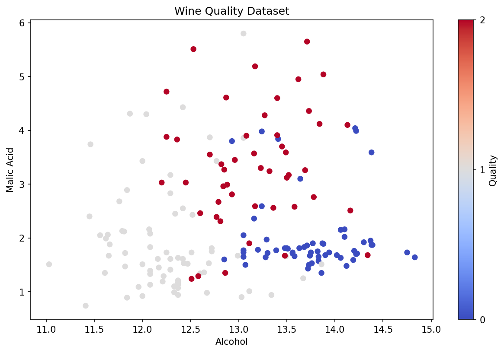
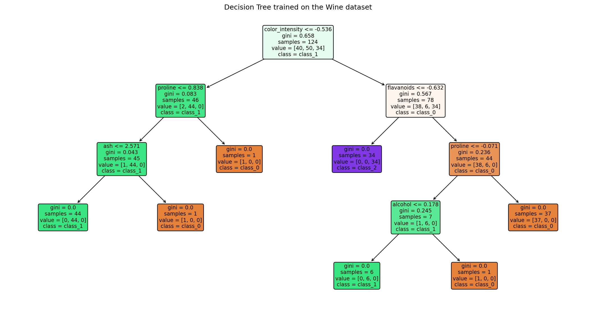
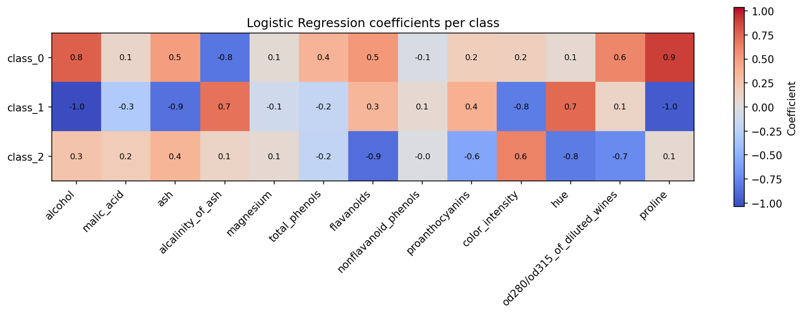
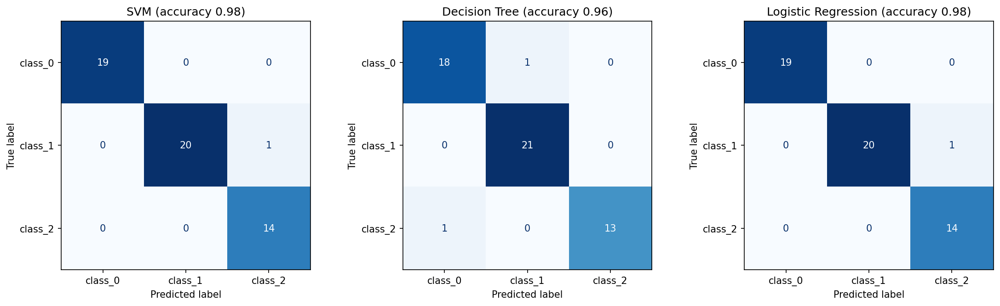

# Assignment 2, Part 1: Wine Classification with Machine Learning

## Task

Using the machine learning code from class, explore a new dataset (Wine), visualize it, split it into training and testing sets, and train a **Decision Tree** and a **Logistic Regression** classifier, using the class SVM code as the example. Compare the models and interpret the results with new plots.

Notebook: [`Nano706_Homework2_part1.ipynb`](Nano706_Homework2_part1.ipynb). The homework section is at the end of the notebook, under **HomeWork**.

## Dataset

The scikit-learn Wine dataset has 178 wine samples and 13 chemical measurements per sample, such as alcohol, malic acid, flavanoids, color intensity, hue and proline. Each wine belongs to one of 3 classes (0, 1, 2). The notebook calls the target "quality", but the classes are actually the three grape cultivars the wines were made from. All features were standardized with `StandardScaler` so that features with large values, like proline, don't dominate.

## Part 1: Visualize the Data

```python
plt.title("Wine Quality Dataset")
plt.xlabel("Alcohol")
plt.ylabel("Malic Acid")
```



Two features alone already separate the classes fairly well:
- Class 0 (blue) has high alcohol and low malic acid.
- Class 1 (grey) has the lowest alcohol.
- Class 2 (red) has the highest malic acid.

Where the classes overlap (around 12.5–13.5% alcohol), the models need the other features.

## Part 2: Split the Data

```python
X_train, X_test, y_train, y_test = train_test_split(X2, y, test_size=0.3, random_state=42)
```

The 70/30 split gives **124 training** and **54 testing** samples (19 / 21 / 14 test samples in classes 0 / 1 / 2).

## Part 3: Decision Tree and Logistic Regression

### Decision Tree

```python
tree = DecisionTreeClassifier(random_state=42)
tree.fit(X_train, y_train)
y_pred_tree = tree.predict(X_test)
accuracy_tree = accuracy_score(y_test, y_pred_tree)
```

**Accuracy: 0.96** (2 of 54 test wines misclassified)



How the tree splits the wines:
- **Color intensity** is the first split. Low color intensity points almost entirely to class 1.
- Among the remaining wines, low **flavanoids** gives a pure group of class 2 (34 of 34).
- High **proline** then picks out class 0.

Several leaves hold only 1 training sample. The tree has memorized a few unusual wines (slight overfitting), which is probably why it makes 2 test errors.

### Logistic Regression

```python
log_regressor = LogisticRegression(max_iter=200)
log_regressor.fit(X_train, y_train)
y_pred_log = log_regressor.predict(X_test)
accuracy_log = accuracy_score(y_test, y_pred_log)
```

**Accuracy: 0.98** (1 of 54 test wines misclassified)



Each row shows how strongly each feature pushes a wine toward that class (red = positive, blue = negative). The results agree with the decision tree:
- **Class 0:** high proline and alcohol.
- **Class 1:** low alcohol, low proline and low color intensity.
- **Class 2:** high color intensity, low flavanoids and low hue.

## Model Comparison



| Model | Test accuracy | Misclassified (of 54) |
|---|---|---|
| SVM (class example) | 0.98 | 1 |
| Decision Tree | 0.96 | 2 |
| **Logistic Regression** | **0.98** | 1 |

All three models perform very well because the three cultivars differ clearly in their chemistry. SVM and Logistic Regression made the same single mistake (a class 1 wine predicted as class 2). The Decision Tree made two different mistakes.

The linear models do slightly better here because the data is small and standardized, and the classes are close to linearly separable. A single decision tree makes hard cut-offs on one feature at a time and overfits more easily. With only 54 test samples, one extra error changes accuracy by about 2%, so the three models are essentially equally good on this dataset.
